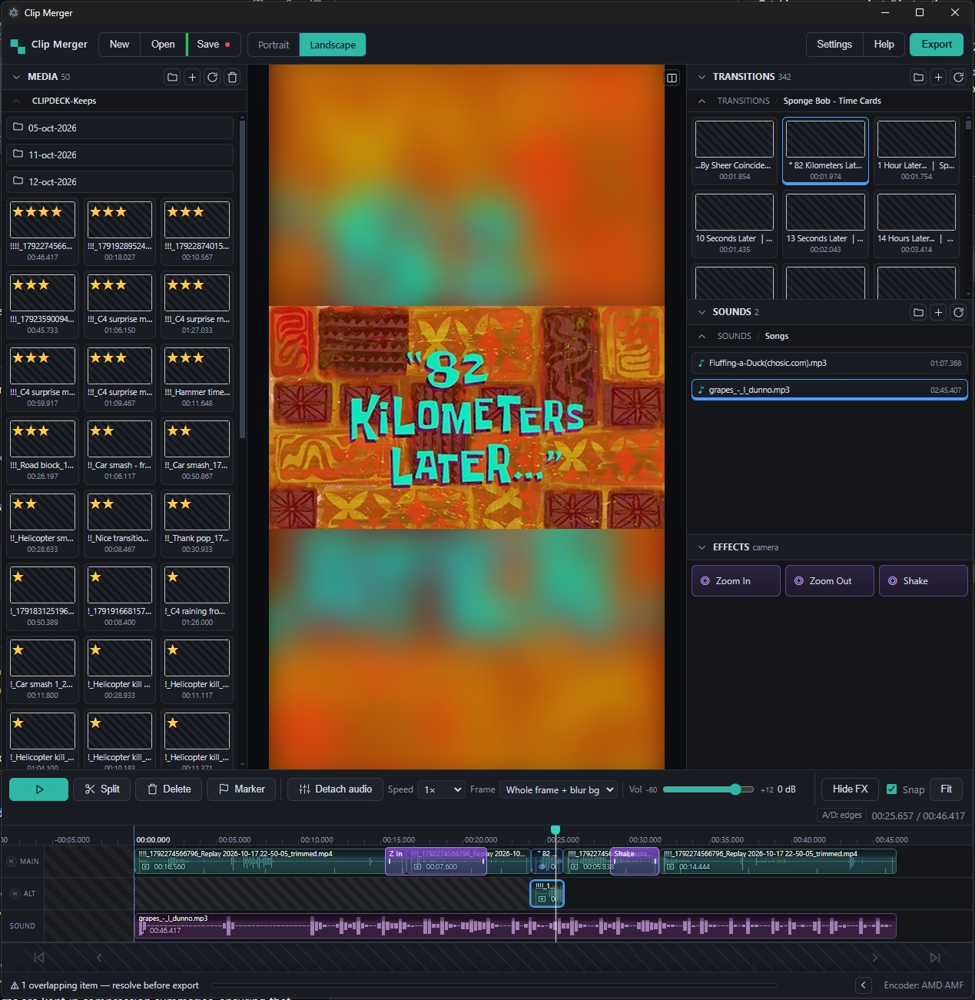

# Clip Merger

A simple, DaVinci-like **clip merger** desktop app for Windows (Electron + ffmpeg).
Put clips, transitions and sounds on a timeline, cut them around, and export a single
merged video — **lossless-first** (stream-copies keyframe-aligned cuts when the source
already matches the export size/FPS).



## Features

- **3 media bins** (across the top, resizable, collapsible, thumbnail grids with own scrollbars):
  **Media** (video clips), **Transitions**, **Sounds** (incl. music). Each points at a
  folder (set with 📁 or in Settings); folders are watched, so files added in Explorer
  appear automatically.
- **Timeline** (bottom, full-width, height-resizable): drag clips from the bins onto it,
  click-drag to **move**, drag edges to **trim** (yellow snap guide), **✂ Split** cuts
  exactly at the orange marker.
- **Playhead/marker** follows your pointer exactly — what you see is where Split cuts
  (press **◆ Marker** to leave a marker at the playhead).
- **Snapping** toggle: snap to timeline start, the marker, and clip/sound edges while
  moving/trimming. Trim edges also snap to source keyframes to keep cuts lossless.
- **Floating editor** (top-right when a clip/sound/marker is selected): timeline start,
  source in/out, Full clip, **Mute**, **Detach audio**, volume, **♫ Detect beats**, Delete.
- **Audio**: per-clip **Mute**; **Detach audio** pulls that clip's exact cut onto the
  sound lane (movable/trimmable/deletable); real **waveform** drawn on every sound;
  **beat markers** auto-detected from a sound's transients so you can snap clips to
  music beats, explosions, shots, etc.
- **Custom timeline scrollbar** (drag the thumb / click the track) and a **✋ hand tool**
  to pan the timeline like a touchpad (middle-drag always pans; wheel works too).
- **Export**: merges clips in timeline order and preserves gaps as black video with
  silence, so output time matches the editor and sounds stay aligned. Keyframe-aligned
  cuts are stream-copied when the source already matches the output size/FPS; other
  cuts are re-encoded with an auto-detected encoder (AMD AMF / NVIDIA NVENC / CPU
  libx264).
- **Save/Open projects** (JSON v6; older projects are normalized on load).
- **Settings persist**: your ffmpeg/ffprobe paths, the three bin folders, output folder,
  encoder, size/FPS and normalize flag are remembered between launches.

## Requirements

- **Node.js 18+** and **npm** (tested on Node 24 / npm 11).
- **ffmpeg + ffprobe** on your PATH (the gyan.dev full build is recommended, e.g.
  `ffmpeg-*-full_build`). If they aren't on PATH, you can point to them in
  **Settings → ffmpeg path / ffprobe path**. Install anywhere and put the `bin` folder
  on PATH, or set the full paths to the `ffmpeg.exe` / `ffprobe.exe`.

## Install & run

```bash
npm install
npm start
```

`npm start` launches the app. On first launch it auto-detects available video encoders
(the first detected one becomes the default; change it in Settings).

## Usage quick-start

1. (Optional) Put clips into `clips/` (or pick any folder in the **Media** bin with 📁).
2. Drag clips from the **Media/Transitions** bins onto the **Clips** lane → they insert
   at the drop position (snap respected). Double-click a tile to append at the end.
3. Drag sounds/music from the **Sounds** bin onto the **Sounds** lane; drag the right
   edge to trim, adjust volume in the editor.
4. Click a clip to move it; drag its edges to trim; put the marker where you want a cut
   and press **✂ Split**. Select a clip and use **Mute** / **Detach audio** as needed.
5. **◆ Marker** to add markers; select a sound and **♫ Detect beats** to wing beats onto
   the timeline, then snap clips onto them.
6. Choose an output path and **Export**.

## Project layout

```
package.json          npm/Electron metadata (npm start)
electron/
  main.js             window + IPC (scan bins, thumbnails, waveform, export, save/load)
  preload.js          safe bridge exposed to the UI (window.api)
  ffmpeg/
    encoders.js       encoder detection + process runners
    probe.js          ffprobe metadata + keyframes
    export.js         the export pipeline (lossless cut → concat → soundboard mix)
renderer/
  index.html          layout (bins / viewer / timeline)
  styles.css          dark theme, timeline, bins, editor
  app.js              all UI logic
merge.bat             your older one-shot batch merge script (kept, not used by the app)
```

## Troubleshooting

- **“Electron failed to install correctly”** (Windows): the npm postinstall download can
  silently fail. Fix:
  1. `Remove-Item -Recurse -Force node_modules\electron\dist`
  2. `node node_modules\electron\install.js`
  3. If it still only writes `LICENSES.*`, extract the cached zip manually:
     ```powershell
     tar -xf "$env:LOCALAPPDATA\electron\Cache\*\electron-vXX-win32-x64.zip" -C node_modules\electron\dist
     Set-Content node_modules\electron\path.txt -Value "electron.exe" -NoNewline
     ```
- **Export fails / “ffmpeg was not found”**: make sure `ffmpeg` and `ffprobe` work in a
  terminal, or set their full paths in Settings.
- **Media bin is empty even though the folder has clips**: the app reads each clip's
  metadata (duration, resolution) with **ffprobe**, and skips files it can't probe — so if
  `ffprobe` is missing the grid stays empty. Install ffmpeg/ffprobe (on PATH) or set their
  paths in **Settings** (saved between launches).
- **Slow encode**: first cuts that land on keyframes are lossless (fast); non-keyframe
  trims need re-encoding. Enable **Snap** when trimming and you'll tend to land on
  keyframes (little white ticks on the clip).
- **Preview is per-clip/gap-jumping**: scrubbing is exact; continuous playback jumps
  across cut boundaries (a small gap is normal).

## Known limits

- Timeline gaps are preserved on export as black video with silence; output time
  matches the editor, and sounds are mixed at their timeline positions.
- Two video lanes: MAIN and ALT. A MAIN clip wins wherever the lanes overlap; clips on
  the same lane may not overlap (the editor blocks export until they are resolved).
- Clips parked in the editing pre-roll (before 0:00) are trimmed to the 0:00 boundary
  on export.
- No built-in frame thumbnails on timeline clips (bins show real frame previews).

## Changelog

Current version: **0.8.1**. See [CHANGELOG.md](CHANGELOG.md) for the full version
history (every release, newest first).